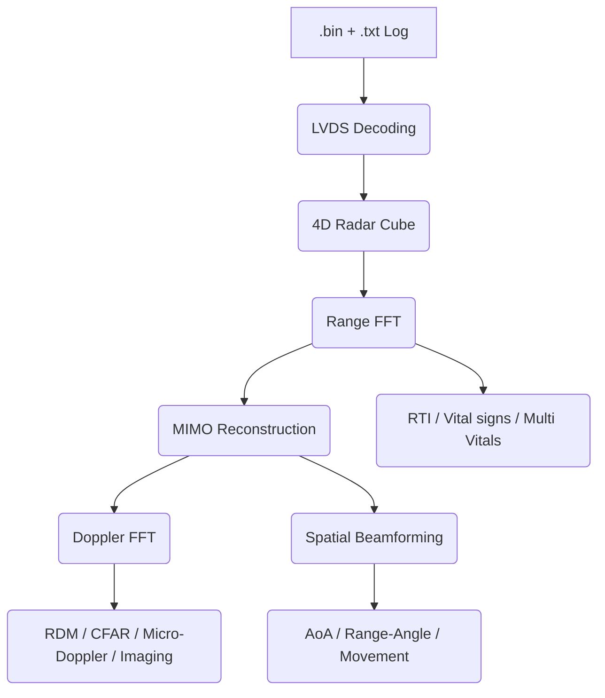

# DARTscope 2.1

Recording and analysis of TI mmWave radar data captured with the DCA1000EVM: a GUI that records
with the radar (without mmWave Studio), checks a recording, and analyses it - range, velocity,
angle, 4D imaging, people and their breathing and heart rate - plus command-line tools for
batch work.

> **The user manual is [`docs/MANUAL.md`](docs/MANUAL.md)** - every tab, button and setting,
> step-by-step workflows, exports and troubleshooting. The same text is the **Manual** tab of the
> application, with a table of contents and search.

## Download and start (Windows)

Run **`DARTscope.exe`** - from the [GitHub Release v2.1](https://github.com/HealthLabVSB/DARTscope/releases/tag/v2.1)
or [`dist/DARTscope.exe`](dist/DARTscope.exe) in this repository. Nothing has to be installed. The
program has no console window; everything it reports appears in its **Log** tab.

- **Recording with the single-chip radar** (IWR6843AOPEVM + DCA1000, Measure tab): mmWave Studio
  2.1.1 has to be installed - the radar's library and firmware come from it; it does not run.
- **Recording with the cascade radar** (AWR2243-2X-CAS-EVM + DCA1000, Measure -> Cascade radar):
  TI UniFlash 8.x or Code Composer Studio 20+ has to be installed - its debugger loads the
  cascade's firmware over the board's USB (JTAG).
- The first recording makes Windows ask whether DARTscope may use the network: allow it, for
  public networks too (the DCA1000's network usually counts as one), or no data arrive.
- Video export (MP4) additionally needs `ffmpeg` on the system PATH.

## What is new in 2.1

- **Heart-rate options of the T-MTT case study**, all opt-in - the default chain is unchanged:
  a notch on every breathing harmonic (`breath_notch="comb"`), prewhitening of the heart-band
  displacement (`heart_prewhiten`, velocity or acceleration), the source of the heart spectrum
  (`heart_method`), and the band-edge index Q_edge with its gate (`q_edge_min`,
  `moving_hr.edge_index`). They are keys of the Vitals configuration (`vitalsigns.py`).
- **The article's analysis scripts** in [`tools/paper`](tools/paper) (vital-sign chain, variants,
  calibration, tables) and [`tools/paper_array`](tools/paper_array) (localization, SNR model,
  interference, TDM, phase-error simulation) - see *Reproducing the article* below.
- **The test suite**: `pip install -r requirements-dev.txt`, then `python -m pytest -q`.

## What is new in 2.0

- **Measure tab - recording without mmWave Studio.** The IWR6843AOPEVM is booted and configured
  through TI's RadarLinkDLL, the DCA1000 controlled over UDP; takes land in exactly the files
  mmWave Studio writes. Settings in physical units with their checks, takes started by the
  operator (button or space bar, countdown), a quick report after each take, and series over a
  range of settings ranked for a kind of movement.
- **Cascade radar.** The AWR2243-2X-CAS-EVM (2x AWR2243 + AM2732R; 6 TX, 8 RX - up to 48 virtual
  channels): presets, every setting checked against the radar, the firmware and the DCA1000
  link, antenna calibration (corner reflector or autofocus), and its takes decoded like any other.
  On macOS and Windows.
- **Fastcheck tab.** One pass over a whole recording: lost packets, clipping, the receivers, glitches,
  the RTI and the energy in the breathing and heart bands, with a verdict.
- **Vital signs.** Breathing and heart rate in three independent views (Vitals, HR, AI), the heart
  from several range bins, a moving person's heart rate, comparison with a reference (PPG and pulse
  of a somnograph); **Multi Vitals** finds several people and gives each one's rates.
- **Imaging.** A 4D point cloud of every frame (range, velocity, azimuth, elevation), objects,
  tracks and the people among them.
- **Micro-Doppler** measures swings of legs and arms and their maximum speed.
- **Playback** through a recording at its real speed, all views following one frame slider; a
  **capture health report** of every recording; the **Log** tab with everything the program reports.
- Windows: sharp at any display scaling, the window fitted to the screen, long recordings
  analysed several times faster, and the status bar shows how long a computation has run and
  about how long it will still take.

## Running from source

Python 3.10 or newer (tkinter comes with Python on Windows and macOS; `python3-tk` on Linux):

```bash
pip install -r requirements.txt
python DCA_processing.py
```

- **Recording on macOS / Linux**: `pip install pyserial pyftdi` and libusb (`brew install libusb`
  on macOS); the radar firmware comes from mmWave Studio 2.1.1 installed in a Wine bottle
  (Whisky, CrossOver) or from `$DARTSCOPE_STUDIO_DIR`. The radar is driven over the DCA1000's USB
  without TI's Windows DLL.
- The Measure tab alone: `python -m acquisition gui`; the cascade alone: `python cascade_gui.py`.

## Building DARTscope.exe

In a clean virtual environment - not Anaconda, whose MKL-based numpy makes a 300 MB exe:

```bat
python -m venv .buildenv
.buildenv\Scripts\python -m pip install -r requirements-build.txt
.buildenv\Scripts\python -m PyInstaller DARTscope.spec --noconfirm --clean
```

The exe appears in `dist\`. It carries the 32-bit Python in [`.py32/`](.py32) (python.org's
3.12.10 embeddable package, 32-bit, unchanged), which runs `acquisition/radarlink_host.py` to load
TI's 32-bit RadarLinkDLL, and the cascade's firmware, JTAG script and target configuration
(`cascade/`). To check a build: `set DARTSCOPE_SELFTEST=report.json` and start the exe - it writes
what it finds (its parts, the radar's library, the boards plugged in) and closes.

## Command-line tools

From the repository folder, `python -m <tool> --help` for the options; described in chapter 11
of the manual.

| Tool | What it does |
|:---|:---|
| `python -m acquisition` | record (`capture`), series of settings (`series`), checks (`check`, `verify`) and the Measure window (`gui`) |
| `python -m tools.health_report` | the capture health report of one or many recordings |
| `python -m tools.decode_check` | decodes every recording of a folder and compares the results |
| `python -m tools.pair_reference` | which somnograph session covers which radar recording, and the offset |
| `python -m tools.vitals_check` | the Vitals view against a somnograph on every covered recording |
| `python -m tools.vital_range_scan` | finds the range of a breathing person, rates per range bin |
| `python -m tools.heart_rate` | the heart rate of a person who may be moving |
| `python -m tools.limb_speed` | swings of legs and arms and their maximum speed |
| `python -m tools.calibrate` | antenna calibration from a corner reflector and its check |
| `python -m tools.cascade_protocol` | verification of the cascade's presets from their own takes ([`docs/CASCADE_PROTOCOL.md`](docs/CASCADE_PROTOCOL.md)) |

## Tests

```bash
pip install -r requirements-dev.txt
python -m pytest -q
```

The tests run on synthetic signals. The few that need the laboratory's recordings look for them
under `DARTSCOPE_DATA` and are skipped without it.

## Reproducing the article

The recordings of the article - 41 takes with their SOMNOtouch reference - are on Zenodo:
[10.5281/zenodo.23762780](https://doi.org/10.5281/zenodo.23762780) (CC BY 4.0). `python -m
tools.vitals_check <set folder> --reference <set folder>/reference` evaluates the Vitals view on
them. The scripts in `tools/paper` and `tools/paper_array` produced the tables of the article;
they read their folders from `DARTSCOPE_PAPER_DATA`, `DARTSCOPE_PAPER_CACHE`,
`DARTSCOPE_PAPER_OUT` and `DARTSCOPE_PAPER_FIGURES`, and expect the recordings under the names
they were made with, before the anonymized names of the dataset. The figures of the article were
drawn by the application.

## Repository structure

| Module | Responsibility |
|:---|:---|
| **`DCA_processing.py`** | Main entry point: the tabbed Tkinter GUI, global state, playback, and all views. |
| **`dca1000_decode.py`**, **`capture_params.py`** | Parser of mmWave Studio logs; the physical parameters (slope, start frequency, bandwidth, resolution, wavelength) and the LVDS lane/format settings. |
| **`radar_processing.py`** | Core signal engine: LVDS demultiplexer, 4D radar cube, range FFT, Range-Doppler maps. |
| **`capture_health.py`**, **`fastcheck.py`**, **`fastcheck_gui.py`** | Health report and the Fastcheck tab. |
| **`AOA.py`**, **`antenna_config.py`**, **`calibration.py`** | Virtual antenna arrays (MIMO), their layouts, calibration, beamforming (Bartlett, Capon). |
| **`detection.py`**, **`clutter.py`**, **`velocity.py`**, **`spectral.py`** | CFAR detection, clutter suppression, velocities beyond the unambiguous limit, sub-bin peak interpolation. |
| **`vitalsigns.py`**, **`hr_analysis.py`**, **`hr_gui.py`**, **`ai_vital_*.py`**, **`moving_hr*.py`**, **`vital_bands.py`** | Breathing and heart rate (Vitals, HR, AI views, moving person). |
| **`multi_vitals*.py`**, **`radar_imaging*.py`**, **`limb_motion.py`** | Multi Vitals, Imaging, Micro-Doppler. |
| **`acquisition/`**, **`measure_gui.py`** | Recording without mmWave Studio and the Measure tab. |
| **`cascade/`**, **`cascade_gui.py`** | The AWR2243 cascade: settings, JTAG ([`cascade/firmware`](cascade/firmware) - TI's SDK cascade test with runtime settings), takes, calibration. |
| **`gui_helper.py`**, **`chirp_design.py`** | The Helper tab: radar configuration calculator. |
| **`theme.py`**, **`flow_layout.py`**, **`plot_interactivity.py`**, **`frame_cache.py`**, **`frame_marker.py`**, **`playback.py`**, **`log_view.py`**, **`manual*.py`** | Look, layout, plots, playback, Log and Manual tabs. |
| **`tools/`** | The command-line tools above; `tools/paper*` the article's analysis scripts. |
| **`test_*.py`**, **`conftest.py`**, **`*_synth.py`** | The test suite and its synthetic recordings. |

## Processing chain



- **Range** (fast time): DC removal, Hann window, FFT - the full complex spectrum for Complex1X.
- **Doppler** (slow time): TDM-MIMO demultiplexing into virtual channels, clutter suppression,
  a second FFT across the chirps.
- **Angle**: the virtual array of TX x RX channels, calibrated, beamformed (Bartlett or Capon).
- **Vital signs**: the unwrapped phase of the chest's range bin, separated into breathing and
  heart bands, rates from their spectra and tracked over time.

## License and citation

MIT - see [`LICENSE`](LICENSE). If you use DARTscope in your research or work, please cite it
([`CITATION.cff`](CITATION.cff)).

Third-party parts: the cascade firmware is built from TI's mmWave MCU+ SDK test code (BSD-3-Clause,
Texas Instruments - [`cascade/firmware/LICENSE-TI.txt`](cascade/firmware/LICENSE-TI.txt)); [`.py32/`](.py32) is python.org's
Python (PSF License, its `LICENSE.txt`); the exe bundles numpy, scipy, matplotlib, scikit-learn
and Pillow under their licenses.

## Authors

**Daniel Barvík** [ORCID: 0000-0001-7699-8792](https://orcid.org/0000-0001-7699-8792)

**Dan Hrubý** [ORCID: 0009-0009-7109-9734](https://orcid.org/0009-0009-7109-9734)

*Part of the [HEALTH.Lab](https://www.fei.vsb.cz/450/en/science-and-research/labs/HEALTHlab/) research.*
